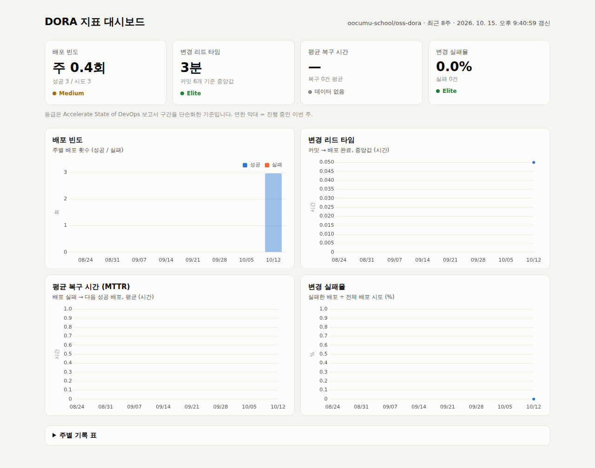

# DORA 지표 자동 수집 & 대시보드

GitHub Actions로 DORA 4대 지표(배포 빈도, 변경 리드 타임, 평균 복구 시간, 변경 실패율)를 자동 수집하고,
Chart.js 대시보드와 이 README의 주간 리포트로 보여 주는 프로젝트입니다.

- 📈 **대시보드**: https://oocumu-school.github.io/oss-dora/
- ⚙️ **워크플로우**: [`dora-metrics.yml`](.github/workflows/dora-metrics.yml) (지표 수집) · [`deploy.yml`](.github/workflows/deploy.yml) (배포)
- 🧮 **수집 스크립트**: [`scripts/collect_dora.py`](scripts/collect_dora.py)

## 1. 과제 수행 항목

| 요구 사항 | 구현 내용 |
|---|---|
| GitHub Actions로 DORA 4대 지표 자동 수집 | `dora-metrics.yml`이 배포 후·매주 월요일·수동 실행 시 GitHub API로 지표를 계산 |
| 대시보드 시안/구현 | `dashboard/index.html` (Chart.js), GitHub Pages로 배포 |
| README에 이미지 첨부 | 지표 그래프(`dora-chart.png`)와 대시보드 화면 캡처(`dashboard.png`)를 워크플로우가 자동 생성·커밋 |
| (선택) JSON 아티팩트 저장 | 매 실행마다 `dora-metrics-<번호>` 아티팩트 업로드 (`latest.json`, `history.json`, 이미지) |
| (선택) 주간 보고서 자동 생성 | 아래 **3. 주간 리포트** 구간이 README에 자동으로 갱신됨 |

## 2. 동작 구조

```
main 에 push ─▶ Deploy 워크플로우 (GitHub Pages 배포)   ── 이 실행 기록이 "배포" 데이터
                      │ 완료되면
                      ▼
            DORA Metrics 워크플로우  ◀── 매주 월요일 00:05 KST / 수동 실행
                      │  GitHub API: 배포 실행 기록 · 커밋 비교 · incident 이슈
                      ▼
      metrics/latest.json, metrics/history.json  ──▶ JSON 아티팩트 업로드
      docs/dora/dora-chart.png, dashboard.png     ──▶ README 이미지 (그래프, 대시보드 자동 캡처)
      README.md (3. 주간 리포트 구간)              ──▶ 자동 커밋
```

### 지표 정의

| 지표 | 계산 방법 | 데이터 출처 |
|---|---|---|
| 배포 빈도 (Deployment Frequency) | 성공한 `Deploy` 실행 수 / 주 | Actions 실행 기록 |
| 변경 리드 타임 (Lead Time for Changes) | 커밋 작성 시각 → 그 커밋이 포함된 첫 성공 배포 완료 시각, **중앙값** | 직전 성공 배포와 이번 배포 사이의 커밋 비교 |
| 평균 복구 시간 (MTTR) | 배포 실패 → 다음 성공 배포까지 시간 + `incident` 라벨 이슈의 생성 → 종료 시간, **평균** | Actions 실행 기록, Issues |
| 변경 실패율 (Change Failure Rate) | 실패한 배포 수 ÷ 전체 배포 시도 수 (취소·건너뜀 제외) | Actions 실행 기록 |

### 등급 기준 (Accelerate State of DevOps 보고서 구간을 단순화)

| 등급 | 배포 빈도 | 리드 타임 | MTTR | 변경 실패율 |
|---|---|---|---|---|
| 🟢 Elite | 주 7회 이상 | 1일 미만 | 1시간 미만 | 15% 이하 |
| 🔵 High | 주 1회 이상 | 1주 미만 | 1일 미만 | 30% 이하 |
| 🟡 Medium | 월 1회 이상 | 1개월 미만 | 1주 미만 | 45% 이하 |
| 🔴 Low | 그 미만 | 1개월 이상 | 1주 이상 | 45% 초과 |

> 주 단위는 한국 시간 월요일 00:00 ~ 일요일 23:59입니다. 최근 8주는 실행할 때마다 API에서 다시 계산합니다.

<!-- DORA:START -->

## 3. 주간 리포트 (자동 생성)

> 이 구간(3-1 ~ 3-4)은 `DORA Metrics` 워크플로우가 실행될 때마다 자동으로 다시 작성됩니다.

### 3-1. 이번 주 지표

> 자동 생성: 2026-10-15 21:40 KST · 이번 주: 2026-10-12 ~ (진행 중) · 지난 주: 2026-10-05 ~ 2026-10-11 · [수집 실행 로그](https://github.com/oocumu-school/oss-dora/actions/runs/38736431582)

| 지표 | 이번 주 (진행 중) | 지난 주 | 최근 8주 | 등급 (최근 8주) |
|---|---:|---:|---:|:---:|
| 배포 빈도 | 3회 | 0회 | 주 0.4회 | 🟡 Medium |
| 변경 리드 타임 | 3분 | — | 3분 | 🟢 Elite |
| 평균 복구 시간 (MTTR) | — | — | — | — |
| 변경 실패율 | 0.0% | — | 0.0% | 🟢 Elite |


<details><summary>주별 기록 펼치기</summary>

| 주 (월요일) | 배포 | 실패 | 리드 타임 | MTTR | 실패율 |
|---|---:|---:|---:|---:|---:|
| 2026-10-12 (진행 중) | 3 | 0 | 3분 | — | 0.0% |
| 2026-10-05 | 0 | 0 | — | — | — |
| 2026-09-28 | 0 | 0 | — | — | — |
| 2026-09-21 | 0 | 0 | — | — | — |
| 2026-09-14 | 0 | 0 | — | — | — |
| 2026-09-07 | 0 | 0 | — | — | — |
| 2026-08-31 | 0 | 0 | — | — | — |
| 2026-08-24 | 0 | 0 | — | — | — |

</details>

### 3-2. 대시보드 화면

실제 페이지: https://oocumu-school.github.io/oss-dora/



### 3-3. 워크플로우 실행 결과

`deploy.yml` 최근 실행 3건 (이 기록으로 지표를 계산합니다)

| 실행 | 결과 | 완료 시각 (KST) | 커밋 | 트리거 |
|---|:---:|---|---|---|
| [#3](https://github.com/oocumu-school/oss-dora/actions/runs/38736377979) | ✅ 성공 | 10/15 21:40 | `ab0338c` feat: 대시보드 자동 캡처와 실행 기록 추가 | push |
| [#2](https://github.com/oocumu-school/oss-dora/actions/runs/38735279759) | ✅ 성공 | 10/15 21:32 | `ea31153` chore: 작은 수정 | push |
| [#1](https://github.com/oocumu-school/oss-dora/actions/runs/38734632351) | ✅ 성공 | 10/15 21:30 | `2362af2` DORA 지표 자동 수집 추가 | push |

### 3-4. JSON 아티팩트

매 실행마다 `latest.json`, `history.json`, 그래프 PNG를 아티팩트로 저장합니다 (보관 90일).

- 이번 실행: **`dora-metrics-4`** → [실행 페이지에서 다운로드](https://github.com/oocumu-school/oss-dora/actions/runs/38736431582)

| 아티팩트 | 크기 | 생성 시각 (KST) |
|---|---:|---|
| [`dora-metrics-3`](https://github.com/oocumu-school/oss-dora/actions/runs/38735385539) | 71.6 KB | 10/15 21:32 |
| [`dora-metrics-2`](https://github.com/oocumu-school/oss-dora/actions/runs/38735118136) | 68.6 KB | 10/15 21:30 |
| [`dora-metrics-1`](https://github.com/oocumu-school/oss-dora/actions/runs/38734664523) | 70.3 KB | 10/15 21:26 |

같은 내용은 저장소에도 커밋됩니다: [`metrics/latest.json`](metrics/latest.json) · [`metrics/history.json`](metrics/history.json)

<details><summary>latest.json 요약 보기</summary>

```json
{
  "generated_at": "2026-10-15T12:40:59.808144+00:00",
  "repository": "oocumu-school/oss-dora",
  "summary": {
    "deployments": 3,
    "deploy_attempts": 3,
    "failed_deployments": 0,
    "deployments_per_week": 0.4,
    "lead_time_hours": 0.05,
    "lead_time_samples": 6,
    "mttr_hours": null,
    "recovery_samples": 0,
    "change_failure_rate": 0.0,
    "grades": {
      "deployments_per_week": "🟡 Medium",
      "lead_time_hours": "🟢 Elite",
      "mttr_hours": "—",
      "change_failure_rate": "🟢 Elite"
    }
  }
}
```

</details>

<!-- DORA:END -->

## 4. 결과 분석

<!-- ✏️ 3-1 표의 숫자를 보고 직접 작성. 아래는 예시 문장이니 실제 값에 맞게 고치기 -->

- **배포 빈도**: 최근 8주 평균 주 N회(등급). 작은 단위로 자주 push 하는 방식이라 ...
- **변경 리드 타임**: 중앙값 N시간(등급). 커밋 후 바로 main에 push 하기 때문에 ...
- **MTTR**: `simulate_failure`로 배포 실패를 N회 발생시켰고, 다음 정상 배포까지 평균 N분이 걸렸다(등급).
- **변경 실패율**: 전체 N회 중 N회 실패로 N%(등급). 실패는 모두 의도적인 시뮬레이션이다.

## 5. 개선 방향 및 한계

- 배포를 "Deploy 워크플로우 성공"으로, 장애를 "배포 실패 + `incident` 이슈"로 근사했다. 실제 서비스라면 모니터링 알림이 incident 이슈를 자동으로 만들도록 연결해야 운영 장애까지 MTTR에 반영된다.
- 리드 타임은 커밋 작성 시각 기준이라 rebase/amend로 시각이 바뀐 커밋은 실제보다 짧게 잡힐 수 있다. PR 기반 개발이라면 PR 생성 시각을 쓰는 방식도 고려할 수 있다.
- 개인 과제 저장소라 배포 횟수가 적어 주별 값의 변동이 크다. 데이터가 쌓일수록 추세가 안정된다.
- 자동 커밋은 `GITHUB_TOKEN`으로 하므로 Deploy를 다시 실행하지 않아 배포 횟수에 섞이지 않는다.